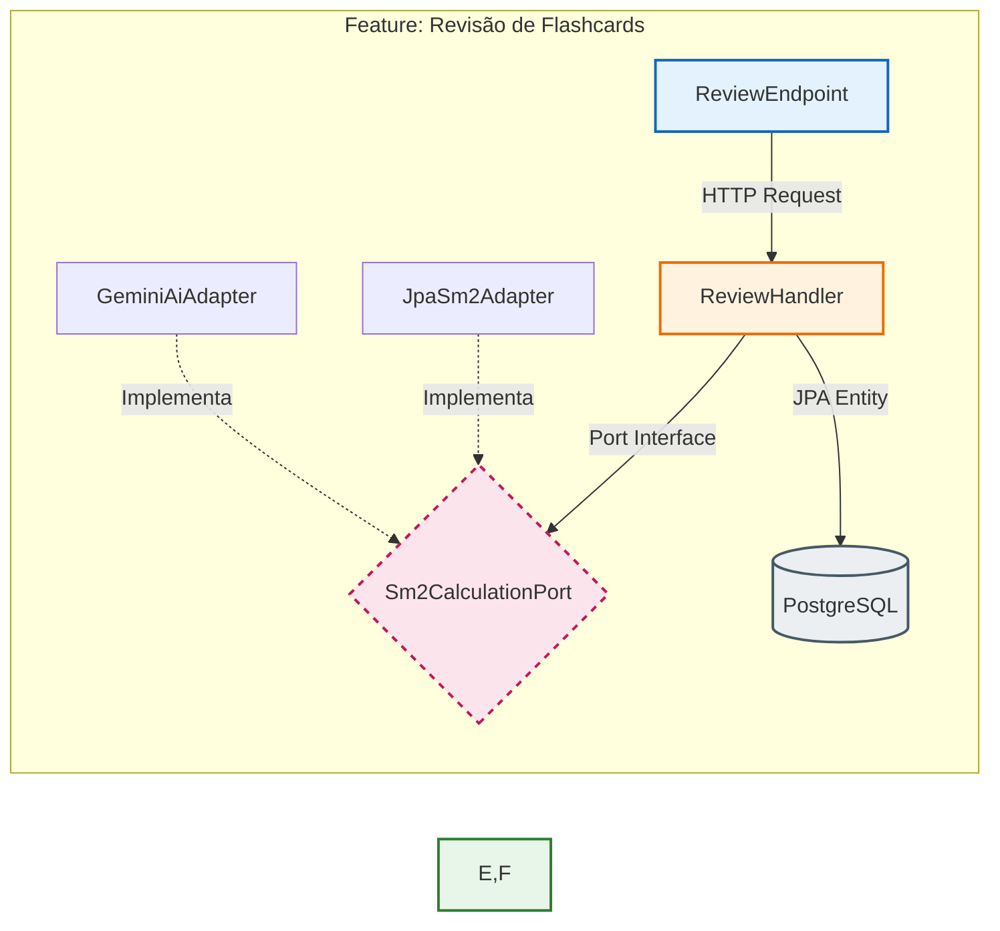

# concurseAI
Flashcards inteligentes que rastreará os resultados esperados antes da prova

#  ConcursoAI Backend

> Um backend de alta performance que gerencia Repetição Espaçada (SM-2) e Caderno de Erros, construído com Java 21 e Quarkus para rodar até no hardware mais limitado.

## ✨ O Que Este Projeto Resolve

Diferente de apps de flashcard genéricos, este backend foi desenhado para **estudo estratégico**:

-   **Algoritmo SM-2 Nativo:** Cálculo matemático preciso de quando revisar, baseado no seu desempenho real (0-5).
-   **Rastreamento de Erros:** Caderno de erros categorizado por tópico para identificar padrões de falha.
-   **Ultra-Leve:** Consome ~150MB de RAM. Desenvolvido pensando em notebooks de entrada (i5 + 12GB).
-   **Paridade Total:** PostgreSQL real em desenvolvimento e produção. Zero surpresas na migração.
-   **Pronto para IA:** Arquitetura preparada para integração futura com LLMs (Gemini/OpenAI) sem refatoração.

## 🏗️ Arquitetura: Vertical Slice + Hexagonal Lite

O projeto abandona a separação tradicional por camadas técnicas (Controller/Service/Repository) e adota uma abordagem híbrida moderna: **Vertical Slice** para organização por funcionalidade e **Hexagonal Lite** para isolamento do domínio.



### Por Que Esta Combinação?

| Padrão | Benefício Técnico | Impacto no Projeto |
| :--- | :--- | :--- |
| **Vertical Slice** | Co-localização: tudo relacionado a uma feature está no mesmo pacote | Onboarding instantâneo; zero "service god class" |
| **Hexagonal Lite** | Domínio isolado via interfaces (Ports); adaptadores plugáveis | Trocar banco ou adicionar IA não toca na lógica SM-2 |
| **Panache Active Record** | Entidades ricas com métodos de persistência embutidos | Redução de 40% de boilerplate vs Repository Pattern |
| **Virtual Threads** | Concorrência massiva sem programação reativa complexa | Código síncrono legível com performance assíncrona real |

### Estrutura de Pastas (Feature-Based)

```text
src/main/java/com/concursoai/
├── flashcards/
│   ├── review/              # Feature completa e autocontida
│   │   ├── ReviewEndpoint.java      # Adapter de entrada (HTTP)
│   │   ├── ReviewHandler.java       # Application Service (orquestração)
│   │   ├── Sm2CalculationPort.java  # Porta de saída (interface pura)
│   │   └── JpaSm2Adapter.java       # Adaptador concreto (JPA/Panache)
│   ├── create/
│   └── Flashcard.java               # Entidade rica (domínio + persistência)
├── errors/
│   ├── register/
│   └── list/
└── shared/
    └── kernel/              # Tipos primitivos, validações genéricas
```

## 🛠️ Stack Tecnológica

| Camada | Tecnologia | Justificativa |
| :--- | :--- | :--- |
| **Core** | Java 21 + Virtual Threads | Concorrência massiva sem bloqueio de I/O |
| **Framework** | Quarkus 3.x (Panache) | Startup < 1s, 70% menos RAM que Spring Boot |
| **Dados** | PostgreSQL 16 (Dev/Prod) | Engine production-grade. H2 apenas em testes |
| **API** | RESTEasy Reactive + Jackson | Contratos tipados e validação automática |
| **Docs** | SmallRye OpenAPI | Swagger UI vivo e sempre atualizado |

## ✅ Funcionalidades Atuais

-   [x] CRUD completo de Flashcards com validação Bean Validation
-   [x] Motor SM-2: Calcula intervalo, fator de dificuldade e próxima revisão
-   [x] Caderno de Erros: Registro e filtragem por matéria/tópico
-   [x] Fila Inteligente: Endpoint `/review` retorna apenas cartões vencidos
-   [ ] Integração IA (Gemini) *(Pós-MVP)*
-   [ ] Autenticação JWT *(v2)*

## ⚙️ Como Rodar Localmente

### Pré-requisitos
-   JDK 21+
-   Docker (para PostgreSQL local) OU conta Supabase Free
-   Gradle Wrapper incluído

### 1. Subir Banco de Dados
```bash
docker compose up -d
# PostgreSQL Alpine (~100MB RAM) rodando em localhost:5432
```

### 2. Iniciar Backend (Hot Reload)
```bash
./gradlew quarkusDev
```
 **Swagger UI:** http://localhost:8080/swagger-ui  
📊 **Health Check:** http://localhost:8080/q/health

### 3. Build Nativo (Opcional)
```bash
./gradlew build -Dquarkus.package.type=native
# Startup: < 0.05s | RAM Base: ~40MB
```

## 📈 Performance no Hardware Real
*(Testado em Lenovo IdeaPad 1 - i5-1235U / 12GB RAM)*

| Métrica | Resultado |
| :--- | :--- |
| Startup (JVM Mode) | ~1.2 segundos |
| Startup (Native Image) | ~0.04 segundos |
| RAM Base (Idle) | ~145 MB |
| Latência P95 (Cálculo SM-2) | < 2ms |

## 🤝 Contribuição & Licença

Este projeto é parte dos meus estudos de backend moderno e preparação para concursos. Sinta-se livre para explorar, forkar ou abrir issues com sugestões.

**Licença:** MIT © 2026 Carlos Eduardo Meireles Leãoicença:** MIT
---
